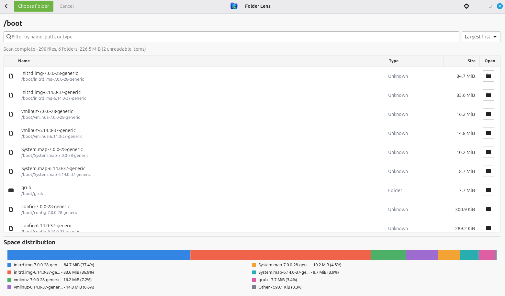

<div align="center">

# Folder Lens

**See what is taking up space - without touching your files.**

A focused, native Linux disk-usage viewer built with Rust and GTK4.

A [SharpLogica](https://sharplogica.com/) project.

[](https://www.rust-lang.org/)
[](https://www.gtk.org/)
[](LICENSE)

[Features](#features) · [Installation](#installation) · [Using Folder Lens](#using-folder-lens) · [Build from source](#build-from-source) · [Privacy and safety](#privacy-and-safety)

</div>



Folder Lens answers a simple question: **which items in this folder are using the most disk space?** Choose a directory and it recursively measures its contents, then presents the immediate files and folders as a searchable, sortable list with a visual space-distribution chart.

Scanning runs on a worker thread, keeping the interface responsive even when a directory contains many files. Folder Lens reads directory entries and file metadata only - it never deletes, moves, or modifies scanned files.

## Features

- **Clear size breakdown** - compare the recursive size of each immediate file and folder
- **Visual distribution** - see the seven largest items at a glance, with the rest grouped as _Other_
- **Responsive scanning** - filesystem work happens away from the GTK interface
- **Live progress** - follow file, folder, byte, and unreadable-item counts as the scan runs
- **Cancellation** - stop a long-running scan at any time
- **Search and sorting** - filter by name or path; sort by largest, smallest, or name
- **Folder navigation** - scan a child folder from its context menu and move back through history
- **Useful actions** - copy an item's path or open it with the system's default application
- **Safe by design** - symlinks and special files are not followed
- **Remembered preferences** - restores the last directory and window size between sessions

## Installation

Folder Lens currently provides packages for 64-bit Intel and AMD (`amd64` /
`x86_64`) Linux systems. Direct package downloads are available from the
[latest GitHub release](https://github.com/mirano-galijasevic/folder-lens/releases/latest).

### Debian, Ubuntu, and Linux Mint

The setup script is available for inspection at
[packaging/install-apt.sh](packaging/install-apt.sh).

Add the signed SharpLogica repository, then install Folder Lens:

```bash
curl -fsSL https://packages.sharplogica.com/install-apt.sh | sudo sh
sudo apt install folder-lens
```

### Fedora

Download the `.rpm` package from the latest GitHub release, then install it
with DNF:

```bash
sudo dnf install ./folder-lens-*.x86_64.rpm
```

### openSUSE

Download the `.rpm` package from the latest GitHub release, then install it
with Zypper:

```bash
sudo zypper install ./folder-lens-*.x86_64.rpm
```

### Arch Linux and Manjaro

Download the `.pkg.tar.zst` package from the latest GitHub release, then
install it with Pacman:

```bash
sudo pacman -U ./folder-lens-*.pkg.tar.zst
```

### Other Linux distributions

Download the `linux-x86_64.tar.gz` archive from the latest GitHub release,
extract it, and run the included executable. GTK 4.10 or newer must already be
installed:

```bash
tar -xzf folder-lens-*-linux-x86_64.tar.gz
cd folder-lens-*-linux-x86_64
./folder-lens
```

## Build from source

Folder Lens requires **Linux**, **Rust 1.92 or newer**, and the GTK4 development libraries.

### 1. Install the system dependencies

On Ubuntu, Linux Mint, or another Debian-based distribution:

```bash
sudo apt update
sudo apt install build-essential libgtk-4-dev pkg-config
```

Install Rust through [rustup](https://rustup.rs/) if it is not already available:

```bash
curl --proto '=https' --tlsv1.2 -sSf https://sh.rustup.rs | sh
source "$HOME/.cargo/env"
```

Confirm that the active toolchain is new enough:

```bash
rustc --version
cargo --version
```

### 2. Build and run Folder Lens

```bash
git clone https://github.com/mirano-galijasevic/folder-lens.git
cd folder-lens
cargo run --release
```

To create an optimized executable without launching it:

```bash
cargo build --release
```

The binary will be written to `target/release/folder-lens`.

## Latest stable release

The latest stable release is **Folder Lens 0.1.0**.

This initial release provides recursive background scanning, cancellation, search and sorting, folder navigation, a filesystem overview, file-type identification, a graphical space-distribution summary, persistent display preferences, and safe open/copy-path actions.

## Changes

### 2026-11-07 - Initial stable application

- Added a filesystem overview with capacity information for local and removable filesystems.
- Added recursive, cancellable background scanning with live file, directory, byte, and error totals.
- Added a structured results table with file type, formatted size, path filtering, and sorting.
- Added folder navigation, history, open-with-default-application, and copy-path actions.
- Added a visual space-distribution chart for the largest entries.
- Added a branded application icon and dedicated About window.
- Added persistent settings for column font, font size, path visibility, sorting, window size, and the last directory.
- Added Snap and loop-device filtering on the filesystem overview.
- Added automated scanner, formatting, chart, settings, and mount-filter tests.

## Using Folder Lens

1. Select **Choose Folder** and pick a directory.
2. Watch the results appear as Folder Lens scans its contents.
3. Search the list or change its sort order to find a particular item.
4. Right-click a folder to scan it, open it, or copy its path.
5. Use the back button to return to the previous directory.

The chart shows how space is divided among the current directory's largest immediate children. Folder sizes include their recursively scanned contents.

## How it works

Folder Lens keeps scanning and presentation deliberately separate:

```text
Selected directory
       │
       ▼
Background scanner ── progress and results ──▶ GTK interface
       │                                           │
       ├─ recursively totals regular files         ├─ searchable list
       ├─ skips symlinks and special files         ├─ sortable results
       └─ records unreadable entries                └─ distribution chart
```

Only immediate children are displayed, while directories are measured recursively. Scan results are sent incrementally to the interface over a channel, so the window remains usable and cancellation can be handled promptly.

## Project layout

| Path | Purpose |
| --- | --- |
| `src/main.rs` | GTK4 interface, application state, navigation, chart, and actions |
| `src/scanner.rs` | Recursive background scanner, progress reporting, and cancellation |
| `src/settings.rs` | JSON-backed window and last-directory preferences |
| `Cargo.toml` | Rust package metadata and dependencies |

## Development

Run the test suite:

```bash
cargo test
```

Run formatting and common Rust lint checks:

```bash
cargo fmt --check
cargo clippy --all-targets --all-features -- -D warnings
```

The scanner tests create temporary directory trees and verify recursive totals and cancellation. Interface helpers are tested separately for size formatting, chart grouping, and label shortening.

## Privacy and safety

Folder Lens works locally and does not upload scan results. During a scan it reads directory entries and file metadata to calculate sizes. It does not read file contents, follow symbolic links, or provide deletion and move operations.

Some paths may be unreadable because of filesystem permissions. Folder Lens skips those entries and reports their count instead of failing the entire scan.

## License

Folder Lens is available under the [MIT License](LICENSE).

Copyright © 2026 Mirano Galijasevic.
